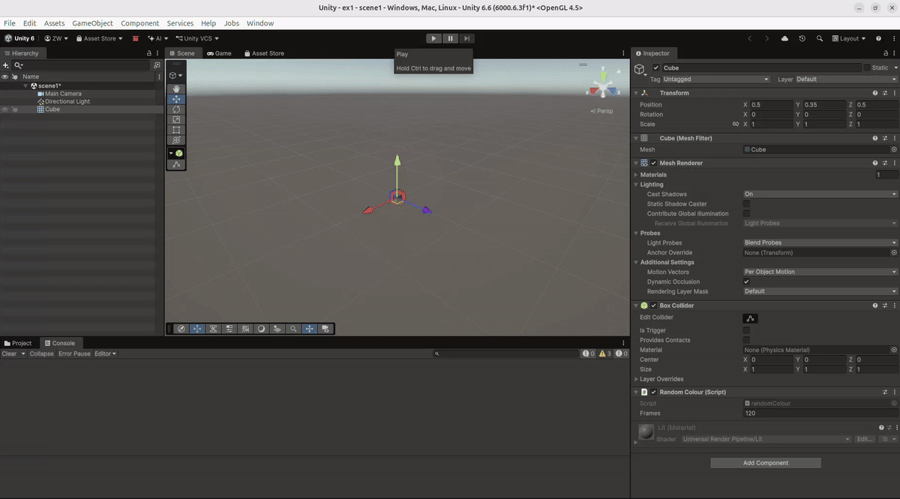
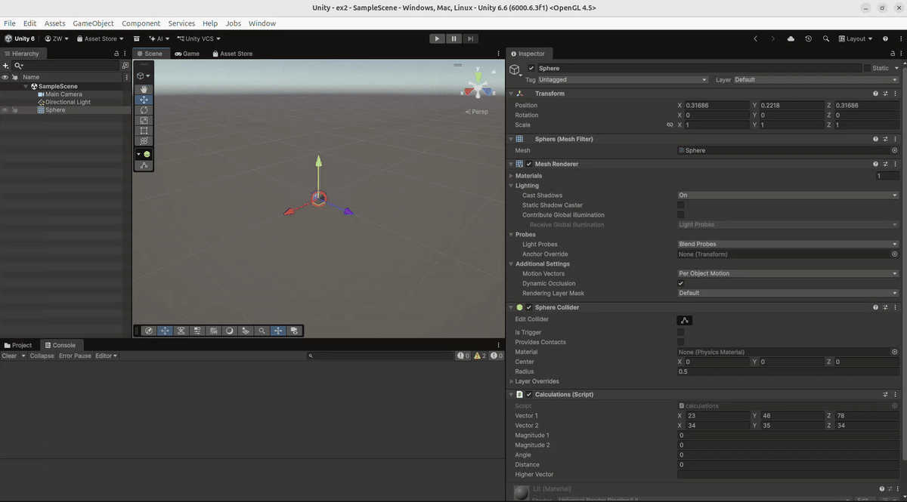
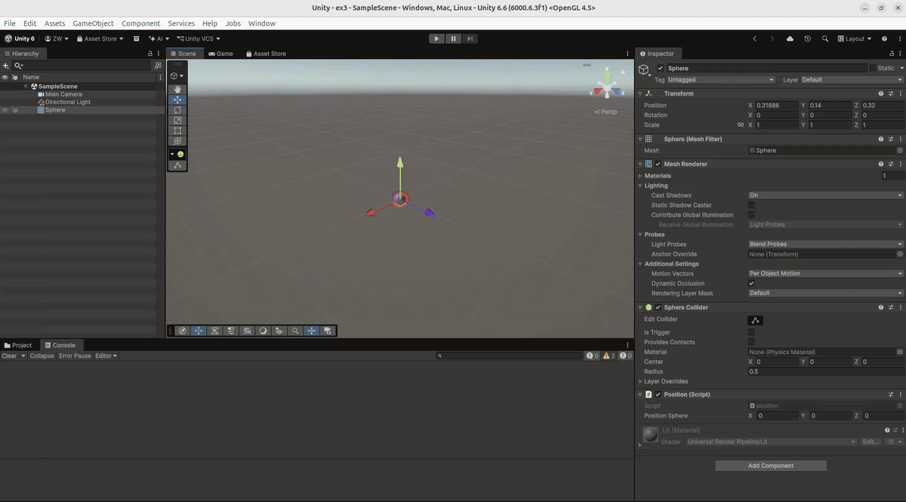
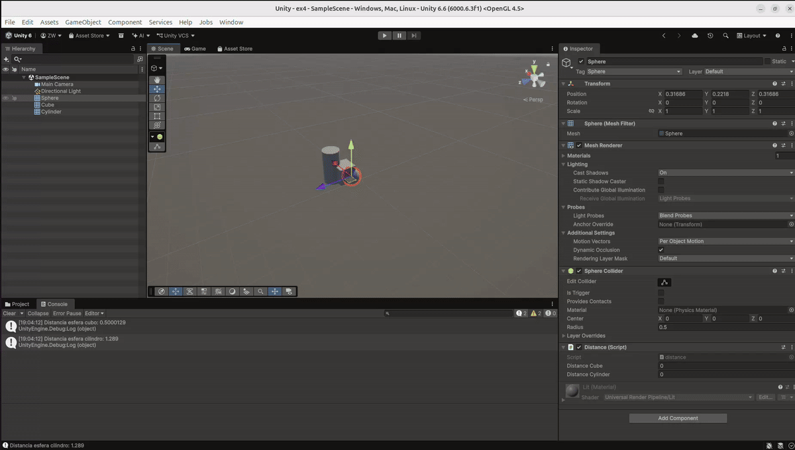

# II, Ejercicios 1-4

## Ejercicio 1, Color aleatorio

En este ejercicio hice un script que crea un color aleatorio para el objeto al empezar la escena.

Cada 120 frames, se cambia aleatoriamente uno de los tres componentes del color (rojo, verde o azul). El número de frames se puede cambiar desde el Inspector.

### Prueba de ejecución

---

## Ejercicio 2, Operaciones con vectores

En este ejercicio utilicé dos vectores `Vector3`, cuyos valores se pueden cambiar desde el Inspector.

El script calcula el módulo de cada vector, el ángulo entre ellos, la distancia entre los dos y cuál de los dos tiene mayor altura utilizando su componente Y.

Los resultados se muestran en el Inspector y en la consola.

### Prueba de ejecución

---

## Ejercicio 3, Posición de la esfera

En este ejercicio obtuve la posición de la esfera utilizando `transform.position`.

La posición se actualiza y se puede ver durante la ejecución.

### Prueba de ejecución

---

## Ejercicio 4, Distancias

En este ejercicio calculé la distancia desde la esfera hasta el cubo y hasta el cilindro.

Para encontrar los objetos utilicé sus etiquetas y después `Vector3.Distance()` para calcular las distancias entre sus posiciones.

Los resultados se muestran en la consola.

### Prueba de ejecución

