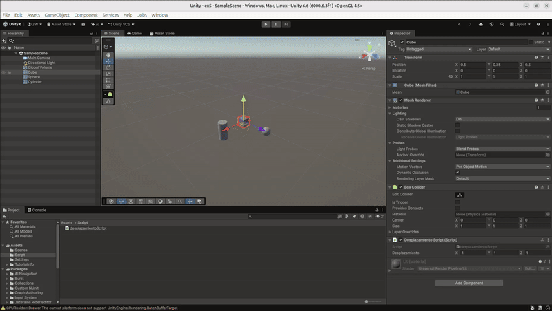
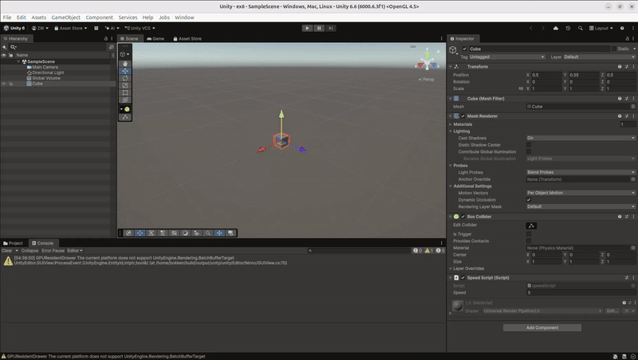
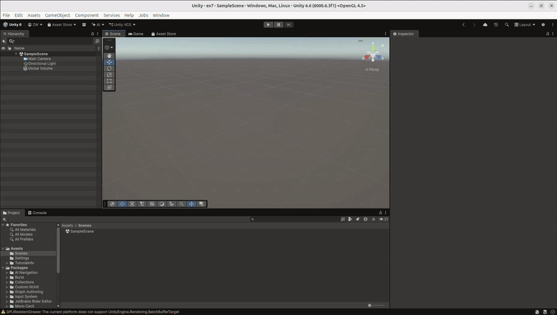
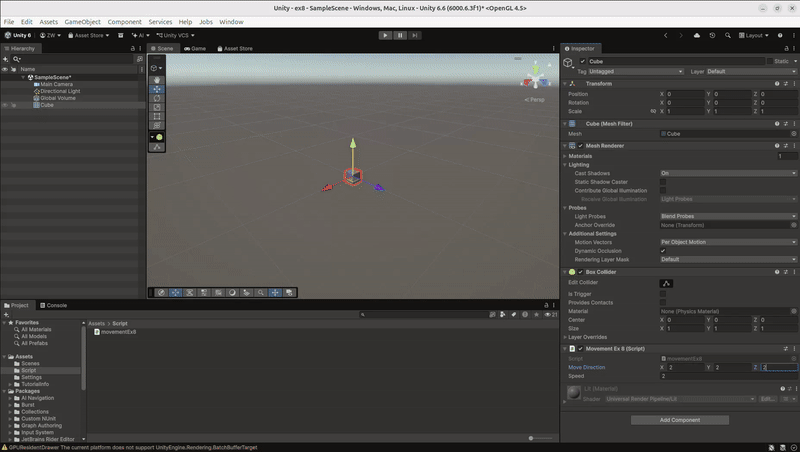
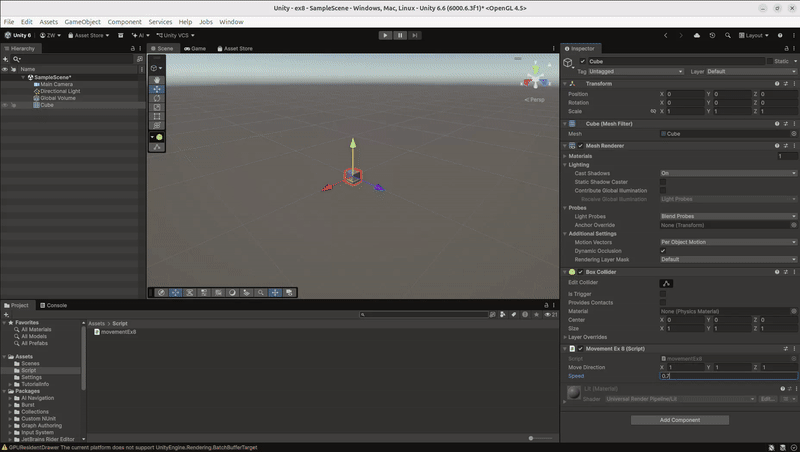
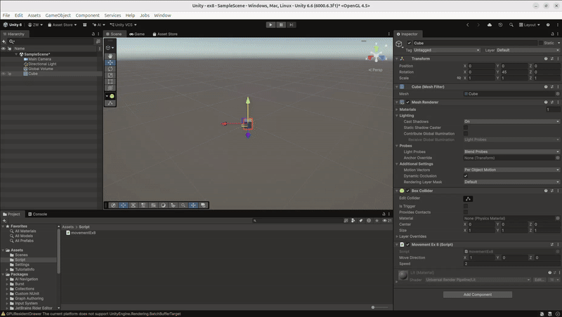
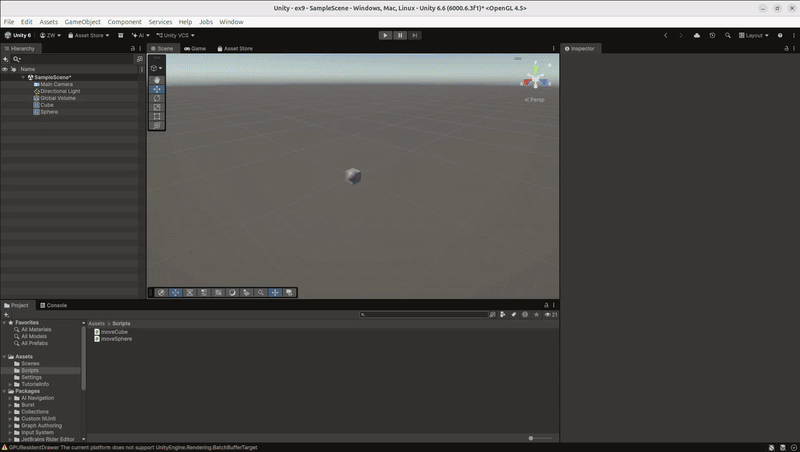
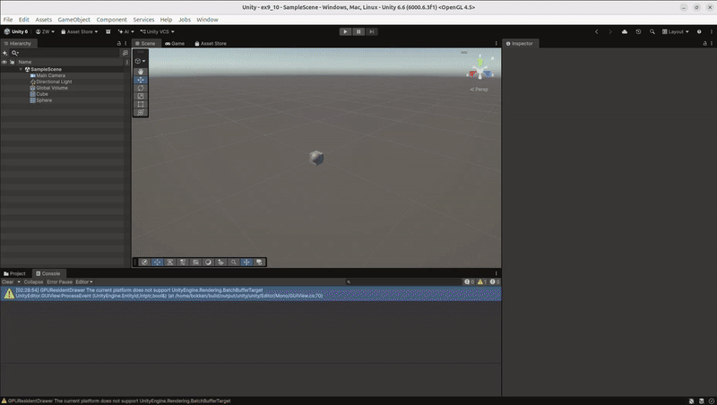
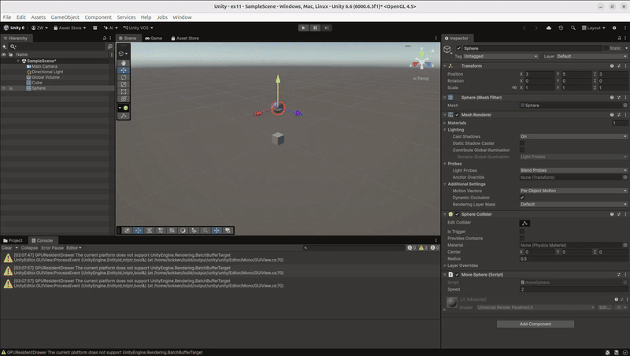
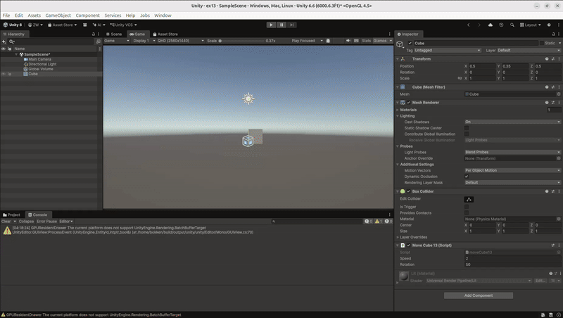

# II, Ejercicios 1-4

## Ejercicio 1, Color aleatorio

En este ejercicio hice un script que crea un color aleatorio para el objeto al empezar la escena.

Cada 120 frames, se cambia aleatoriamente uno de los tres componentes del color (rojo, verde o azul). El número de frames se puede cambiar desde el Inspector.


## Ejercicio 2, Operaciones con vectores

En este ejercicio utilicé dos vectores `Vector3`, cuyos valores se pueden cambiar desde el Inspector.

El script calcula el módulo de cada vector, el ángulo entre ellos, la distancia entre los dos y cuál de los dos tiene mayor altura utilizando su componente Y.

Los resultados se muestran en el Inspector y en la consola.


## Ejercicio 3, Posición de la esfera

En este ejercicio obtuve la posición de la esfera utilizando `transform.position`.

La posición se actualiza y se puede ver durante la ejecución.


## Ejercicio 4, Distancias

En este ejercicio calculé la distancia desde la esfera hasta el cubo y hasta el cilindro.

Para encontrar los objetos utilicé sus etiquetas y después `Vector3.Distance()` para calcular las distancias entre sus posiciones.

Los resultados se muestran en la consola.


# 5. Desplazamiento

Obtener la posición original del objeto usando `transform.position` en `Start`. Después, si se pulsa la barra espaciadora (`"Jump"`), cambiar la posición del objeto a la posición original + el vector de desplazamiento indicado.



# 6. speedScript

Primero, declarar la velocidad del cubo.

Después, usar `Input.GetAxis()` para leer la entrada del usuario en el eje.

Luego, usar `Input.GetKey(KeyCode.)` para comprobar qué teclas específicas se han pulsado y, con eso, imprimir la tecla pulsada junto con su velocidad.



# 7. Configuración de entrada

Edit → Project Settings → Input Manager → Fire1 → Alt Positive Button = `h`



# 8. Sin cambios


## a)

El cubo se mueve el doble de rápido cuando se duplican las coordenadas.



## b)

El cubo se mueve el doble de rápido cuando se duplica la velocidad.


## c)

Con la nueva velocidad de `0.7`, el cubo se mueve más despacio.



## d)

El cubo comienza a una altura de 2 y continúa moviéndose a lo largo del eje X manteniendo exactamente esa altura.


## e)

```csharp
transform.Translate(moveDirection.x * speed, moveDirection.y * speed, moveDirection.z * speed);
```

El cubo se mueve a lo largo de sus propios ejes.



```csharp
transform.Translate(moveDirection.x * speed, moveDirection.y * speed, moveDirection.z * speed, Space.Self);
```

El cubo se mueve a lo largo de sus propios ejes.


```csharp
transform.Translate(moveDirection.x * speed, moveDirection.y * speed, moveDirection.z * speed, Space.World);
```

El cubo se mueve a lo largo de los ejes del mundo (permanece girado en un ángulo de 45 grados).


# 9. Movimiento del cubo y de la esfera

Los controles del cubo y de la esfera utilizan los mismos ejes horizontal y vertical. Por eso no se podía utilizar `Input.GetAxis`, ya que, de lo contrario, tanto el cubo como la esfera empezarían a moverse al mismo tiempo. Por eso, el código comprueba exactamente qué tecla se ha pulsado y después la suma al eje correspondiente del objeto. Esto se multiplica por la velocidad en `transform.Translate`, que mueve el objeto.



# 10. Time.deltaTime

Se añadió `Time.deltaTime` al cálculo de `transform.Translate()` tanto para el cubo como para la esfera.



# 11. Movimiento hacia la esfera

`Transform` de la esfera permite obtener información sobre ella.

Después, se calcula la dirección desde el cubo hasta la esfera restando la posición del cubo a la posición de la esfera. `direction.y` se establece en `0` para que la altura del cubo no cambie.

A continuación, se calcula la distancia que recorre el cubo por fotograma a la velocidad indicada y se compara con la distancia entre el cubo y la esfera. El cubo solo puede moverse si la distancia es mayor, para evitar que se mueva hacia delante y hacia atrás. Después, se normaliza `direction` para que la distancia no influya en el movimiento del cubo y, finalmente, se calcula la transformación para moverlo.



# 12. Orientación hacia la esfera

`Transform` de la esfera permite obtener información sobre ella.

Después, se crea el vector de dirección utilizando las coordenadas X y Z de la esfera, pero manteniendo la altura original del cubo. A continuación, se hace que el cubo mire en esa dirección utilizando `LookAt`. Ahora, la dirección hacia delante del cubo apunta hacia la esfera; por eso se utiliza `Vector3.forward` en `transform.Translate()` para mover el cubo (hacer que el cubo avance siempre hará que se mueva hacia la esfera, ya que está orientado hacia ella).


# 13. Movimiento y rotación

Establecer una velocidad y una velocidad de rotación para el cubo.

Después, obtener la entrada `Horizontal` del usuario para saber en qué dirección debe girar el cubo. A continuación, girar el cubo alrededor del eje Y utilizando la entrada horizontal y la velocidad de rotación del cubo. Después, utilizar `transform.forward` para mover el cubo hacia delante a una velocidad determinada y añadir continuamente ese desplazamiento a la posición del cubo (`transform.position`). Por último, utilizar `Debug.DrawRay` para identificar la dirección del movimiento del cubo.


